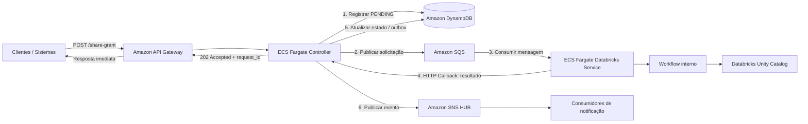

# 01 — Visão geral da arquitetura

## 1. Objetivo

Disponibilizar uma API assíncrona para receber solicitações de concessão ou revogação de permissões no Databricks Unity Catalog. A API confirma a aceitação ao produtor sem aguardar o processamento Databricks; o resultado final é comunicado posteriormente por callback e notificação centralizada.

## 2. Escopo

### Incluído

- Recepção de solicitações via Amazon API Gateway.
- Validação inicial e coordenação pelo ECS Controller.
- Registro do estado global no Amazon DynamoDB.
- Despacho assíncrono para Amazon SQS.
- Processamento pelo ECS Fargate `analytics-share-grant-dbx-service`.
- Organização interna do serviço Databricks usando arquitetura hexagonal.
- Integração com Unity Catalog por meio do Databricks SDK.
- Callback HTTP para comunicar o resultado ao Controller.
- Atualização do estado global e publicação de notificação no Amazon SNS.
- Segurança, observabilidade, resiliência e operação.

### Fora do escopo inicial

- Um ECS independente para cada etapa do workflow Databricks.
- Um orquestrador distribuído separado para as etapas internas.
- Step Functions para orquestrar o fluxo Databricks inicial.
- Publicação direta do serviço Databricks no SNS HUB.
- Gerenciamento de permissões do próprio Lake Formation por este serviço.
- Garantia de processamento exactly-once.

## 3. Visão lógica

> O diagrama representa a sequência lógica. A implementação deve tratar explicitamente falhas entre as operações no DynamoDB, SQS e SNS, pois elas não participam de uma única transação distribuída.

## 4. Componentes e responsabilidades

### 4.1 Clientes

Sistemas corporativos, usuários internos ou automações que solicitam operações de Grant e Revoke.

### 4.2 Amazon API Gateway

- Expor a API de entrada.
- Aplicar autenticação/autorização de borda, throttling e validações básicas.
- Encaminhar a solicitação ao Controller.
- Não conter regras de negócio de autorização do Unity Catalog.

### 4.3 ECS Fargate Controller

Componente de coordenação e integração do fluxo global.

Responsabilidades:

- Validar o contrato de entrada e regras de aceitação da solicitação.
- Gerar ou validar um identificador único (`request_id`).
- Registrar a solicitação no DynamoDB.
- Publicar a mensagem na fila SQS apropriada.
- Manter o estado global da solicitação.
- Expor endpoint de callback autenticado para o serviço Databricks.
- Atualizar o estado final e produzir a notificação para o SNS HUB.
- Expor consulta de status, caso esse requisito seja habilitado.

O Controller **não** deve executar chamadas de negócio ao Unity Catalog nem decidir a sequência interna das etapas Databricks.

### 4.4 Amazon DynamoDB

Armazenar o estado global e os metadados de controle da solicitação.

Responsabilidades:

- Registrar a solicitação e seu ciclo de vida.
- Permitir atualizações condicionais para evitar transições inválidas.
- Guardar identificadores de correlação e informações necessárias à recuperação.
- Opcionalmente armazenar um registro de Outbox para publicação confiável do evento final.

### 4.5 Amazon SQS

Desacoplar o recebimento da solicitação de seu processamento.

Responsabilidades:

- Absorver picos de entrada.
- Manter mensagens até o consumo.
- Permitir controle de concorrência e retentativas.
- Encaminhar mensagens que excedam a política de tentativas para uma Dead-Letter Queue (DLQ).

### 4.6 ECS Fargate `analytics-share-grant-dbx-service`

Executar o processamento de negócio no Databricks.

Responsabilidades:

- Consumir mensagens da SQS.
- Validar o conteúdo necessário ao processamento.
- Planejar e executar o workflow interno de Grant/Revoke.
- Consultar e alterar permissões no Unity Catalog.
- Aplicar idempotência e política de retry.
- Enviar o resultado final ao Controller por callback HTTP.

### 4.7 Databricks Unity Catalog

Sistema externo no qual as permissões são consultadas, concedidas ou revogadas.

Exemplos de privilégios previstos no escopo inicial:

| Recurso | Privilégio típico |
|---|---|
| Catalog | `USE CATALOG` |
| Schema | `USE SCHEMA` |
| Table / View | `SELECT` |

A matriz definitiva deve ser validada contra as políticas de acesso e a versão/API do Unity Catalog utilizada.

### 4.8 Amazon SNS HUB

Distribuir o evento de conclusão para sistemas consumidores. O Controller é o responsável pela publicação, evitando que cada serviço de domínio implemente integração própria com o HUB.

## 5. Fluxo ponta a ponta

1. O cliente envia uma solicitação ao API Gateway.
2. O API Gateway encaminha a solicitação ao Controller.
3. O Controller valida a solicitação e registra `dispatch_status = PENDING` no DynamoDB.
4. O Controller publica a mensagem na SQS.
5. Após confirmação de envio pela SQS, o Controller atualiza `dispatch_status = DISPATCHED`.
6. O Controller responde ao produtor com HTTP `202 Accepted`, incluindo `request_id` e estado de aceitação. Essa resposta não aguarda o consumo da mensagem nem a execução do workflow Databricks.
7. O serviço Databricks consome a mensagem e executa seu workflow interno.
8. Ao concluir, o serviço chama o endpoint de callback do Controller com o resultado.
9. O Controller valida o callback, atualiza o estado global e registra o evento de notificação.
10. Um publisher publica o evento no SNS HUB e registra a publicação como concluída.

### Observação sobre o passo 5

O Controller é o produtor da mensagem da SQS e o ECS Databricks é o consumidor. O Controller responde ao produtor assim que a solicitação estiver aceita e despachada; não espera o consumidor iniciar ou concluir. O callback percorre o sentido inverso, via HTTP, do serviço Databricks para o Controller, após o processamento.

## 6. Restrições e princípios

- Processamento assíncrono: a resposta inicial não deve aguardar a execução completa no Databricks.
- Idempotência: reentregas de SQS e callbacks repetidos não podem provocar efeitos indevidos.
- Responsabilidade única: Controller coordena o fluxo global; serviço Databricks executa o domínio Databricks.
- Dependência de abstrações: adapters concretos implementam Ports definidos pela aplicação.
- Evolução incremental: começar com workflow interno no único ECS Databricks.

## 7. Contrato temporal da API

A chamada do produtor é síncrona somente até o Controller confirmar a aceitação e o despacho para a SQS. A resposta esperada é `202 Accepted` com `request_id`. O Controller não espera:
- O ECS Databricks iniciar o processamento.
- O workflow interno terminar.
- O callback chegar.
- A notificação SNS ser publicada.

O resultado final é assíncrono. Pode ser consultado por endpoint de status, se implementado, ou recebido pelo canal de notificação corporativo.

**Importante:** se a SQS confirmar o recebimento, mas o Controller falhar antes de persistir `DISPATCHED`, a recuperação pode ocasionar reenvio. A resposta ao produtor deve refletir o que o Controller conseguiu confirmar; idempotência e reconciliação tratam o cenário ambíguo.
