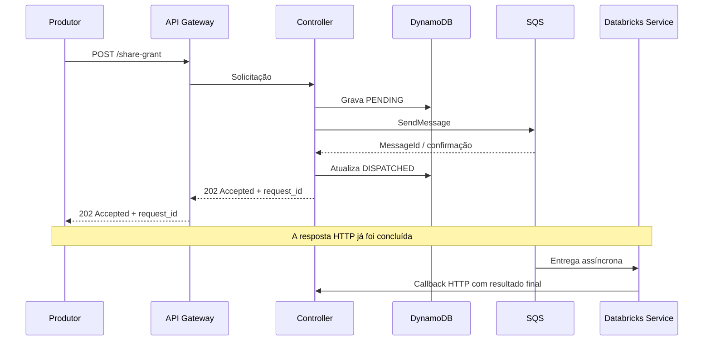

# 03 — Controller: API e integração

## 1. Objetivo

Definir os contratos lógicos entre clientes, Controller e serviço Databricks. Os exemplos são ilustrativos e devem ser alinhados ao padrão de API corporativo.

## 2. Endpoint de submissão

`POST /share-grant`

### Exemplo de requisição

```json
{
  "operation": "GRANT",
  "workspace_id": "workspace-identifier",
  "principal": {
    "type": "GROUP",
    "name": "analytics_readers"
  },
  "resource": {
    "type": "TABLE",
    "catalog": "shared",
    "schema": "sales",
    "name": "orders"
  },
  "requested_privileges": [
    "SELECT"
  ],
  "metadata": {
    "requested_by": "system-a",
    "correlation_id": "corr-123"
  }
}
```

### Exemplo de resposta

```json
{
  "request_id": "req-uuid",
  "status": "ACCEPTED",
  "dispatch_status": "PENDING"
}
```

O status HTTP recomendado é `202 Accepted`. A resposta é enviada ao produtor depois que o Controller validou a solicitação, persistiu o registro e obteve confirmação de publicação na SQS (e atualizou `dispatch_status = DISPATCHED`). A API confirma aceitação para processamento assíncrono; não confirma o resultado do Grant/Revoke.

### Semântica temporal da API

A requisição HTTP do produtor cobre somente a aceitação e o despacho:



Se a publicação na SQS falhar ou não puder ser confirmada, o Controller não deve responder como se o despacho estivesse concluído. Deve aplicar a política de erro/retry e manter o registro recuperável. A API não deve esperar o processamento, mas pode aguardar as operações rápidas de validação, persistência inicial e despacho necessárias para confirmar a aceitação.

## 3. Mensagem enviada à SQS

A mensagem deve carregar o identificador global e os dados mínimos necessários para executar o pedido.

```json
{
  "message_version": "1",
  "request_id": "req-uuid",
  "operation": "GRANT",
  "workspace_id": "workspace-identifier",
  "principal": {
    "type": "GROUP",
    "name": "analytics_readers"
  },
  "resource": {
    "type": "TABLE",
    "catalog": "shared",
    "schema": "sales",
    "name": "orders"
  },
  "requested_privileges": ["SELECT"],
  "correlation_id": "corr-123"
}
```

Recomendações:
- Incluir `message_version` para evolução compatível do contrato.
- Não incluir segredos, tokens OAuth ou credenciais.
- Incluir `request_id` e `correlation_id`.
- Definir política de retenção e DLQ.
- Validar o tamanho máximo da mensagem; para payloads maiores, avaliar armazenamento externo e referência por chave.

## 4. Endpoint de callback

`POST /share-grant/{request_id}/result`

### Exemplo de callback com sucesso

```json
{
  "event_id": "evt-uuid",
  "status": "SUCCEEDED",
  "started_at": "2026-11-10T20:00:00Z",
  "finished_at": "2026-11-10T20:00:42Z",
  "result": {
    "operation": "GRANT",
    "resource": "shared.sales.orders",
    "principal": "analytics_readers",
    "applied_privileges": ["SELECT"]
  }
}
```

### Exemplo de callback com falha

```json
{
  "event_id": "evt-uuid",
  "status": "FAILED",
  "started_at": "2026-11-10T20:00:00Z",
  "finished_at": "2026-11-10T20:00:42Z",
  "error": {
    "code": "UNITY_CATALOG_PERMISSION_DENIED",
    "message": "The service principal does not have sufficient privileges."
  }
}
```

### Resposta do Controller

```json
{
  "request_id": "req-uuid",
  "callback_status": "ACCEPTED"
}
```

O callback é uma nova chamada HTTP feita pelo serviço Databricks após a execução. Ele não é uma continuação da requisição original do produtor. O callback deve retornar sucesso apenas depois de persistir o resultado de forma durável. Se o Controller não conseguir persistir, deve retornar erro transitório para permitir retry do serviço chamador.

## 5. Consulta do resultado

A resposta `202 Accepted` deve incluir `request_id`. O produtor precisa de um mecanismo posterior para consultar o resultado, caso necessite obter o estado diretamente. Uma opção é expor `GET /share-grant/{request_id}` no Controller, protegido pelas mesmas regras de autenticação/autorização da API. Alternativamente, o produtor pode consumir o evento final publicado no SNS HUB por meio da integração corporativa existente.

Não manter a conexão HTTP original aberta até o fim do processamento. O callback Databricks → Controller e a notificação SNS são mecanismos posteriores de atualização do resultado.

## 6. Autenticação e autorização do callback

Opções a avaliar:
- IAM/SigV4, se compatível com o padrão de comunicação adotado.
- OAuth2 client credentials ou JWT de serviço.
- mTLS em ambientes que já ofereçam essa infraestrutura.

Requisitos:
- Autenticar a identidade do serviço chamador.
- Autorizar somente o serviço Databricks esperado.
- Validar se o `request_id` existe e está associado ao destino Databricks.
- Rejeitar callbacks incompatíveis com o estado atual.
- Não confiar em `request_id` como mecanismo de autenticação.

## 7. Idempotência

- A submissão deve aceitar uma chave de idempotência ou produzir um `request_id` estável para uma solicitação repetida, conforme política da API.
- O Controller deve rejeitar ou devolver o resultado existente para submissões duplicadas, em vez de criar operações repetidas.
- O callback deve ser idempotente por `event_id` e `request_id`.
- Se a mesma solicitação receber callbacks conflitantes, aplicar regra explícita: por exemplo, aceitar apenas uma transição terminal válida e registrar conflito para análise.

## 8. Erros e códigos

| Código lógico | Significado | Tratamento esperado |
|---|---|---|
| `INVALID_REQUEST` | Payload inválido | Corrigir a solicitação |
| `REQUEST_ALREADY_EXISTS` | Chave idempotente já utilizada | Retornar solicitação existente |
| `REQUEST_NOT_FOUND` | `request_id` inexistente | Não repetir indefinidamente |
| `INVALID_STATE_TRANSITION` | Transição não permitida | Registrar e investigar |
| `UNAUTHORIZED_CALLBACK` | Identidade não autorizada | Bloquear e auditar |
| `TEMPORARY_FAILURE` | Falha transitória | Retry com backoff |
