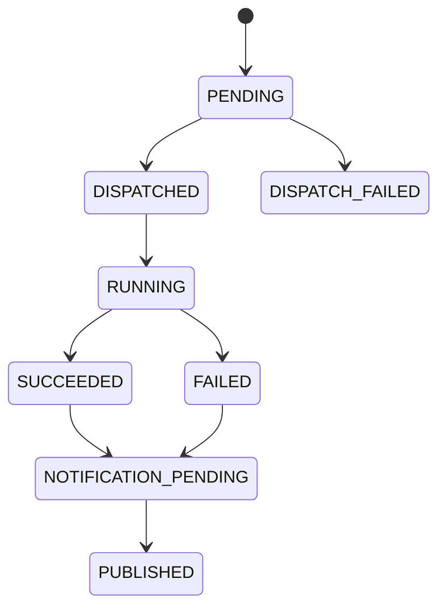

# 04 — Modelo de dados e estados

## 1. Objetivo

Definir o modelo lógico do estado global mantido pelo Controller no DynamoDB. O desenho físico (PK/SK, GSIs, TTL e estratégia de particionamento) deve ser validado com os padrões da plataforma.

## 2. Atributos sugeridos

| Atributo | Tipo | Descrição |
|---|---|---|
| `request_id` | String | Identificador único da solicitação |
| `operation` | String | `GRANT` ou `REVOKE` |
| `target` | String | Destino lógico, por exemplo `DATABRICKS` |
| `dispatch_status` | String | Estado do despacho à SQS; determina quando a API pode confirmar a aceitação |
| `execution_status` | String | Estado global da execução |
| `notification_status` | String | Estado da notificação SNS |
| `created_at` | String | Data/hora de criação |
| `updated_at` | String | Data/hora da última atualização |
| `correlation_id` | String | Correlação ponta a ponta |
| `idempotency_key` | String | Chave de idempotência, quando fornecida |
| `result` | Map | Resultado final resumido |
| `error` | Map | Erro final normalizado |

Não persistir credenciais ou tokens.

## 3. Estados

### Despacho

| Estado | Significado |
|---|---|
| `PENDING` | Solicitação registrada; despacho ainda não confirmado |
| `DISPATCHED` | SQS confirmou aceitação da mensagem |
| `DISPATCH_FAILED` | Falha definitiva no despacho, após política de retry |

`DISPATCHED` não significa que o consumidor iniciou ou concluiu o processamento. É o marco usado pelo Controller para responder `202 Accepted` ao produtor, pois a mensagem foi aceita pela SQS.

### Execução

| Estado | Significado |
|---|---|
| `NOT_STARTED` | Ainda não iniciado |
| `RUNNING` | Serviço Databricks iniciou o processamento |
| `SUCCEEDED` | Execução concluída com sucesso |
| `FAILED` | Execução concluída com falha |
| `UNKNOWN` | Estado precisa de reconciliação, quando aplicável |

### Notificação

| Estado | Significado |
|---|---|
| `PENDING` | Evento de notificação persistido, aguardando publicação |
| `PUBLISHED` | SNS confirmou a publicação |
| `FAILED` | Falha que excedeu a política de retry e requer intervenção |

## 4. Transições de referência



A transição para `RUNNING` pode ser registrada pelo Controller após um evento de início enviado pelo serviço, ou inferida por callback/progresso, conforme o contrato escolhido. Não assumir que o envio da mensagem à SQS comprova início do processamento.

## 5. Padrão de persistência e despacho

Não existe transação atômica entre DynamoDB e SQS.

Fluxo inicial recomendado:
1. Gravar solicitação como `dispatch_status = PENDING`.
2. Publicar mensagem na SQS.
3. Após confirmação de envio, atualizar para `DISPATCHED` com atualização condicional.
4. Se o processo falhar entre os passos 2 e 3, a solicitação pode permanecer `PENDING` mesmo que a mensagem tenha sido enviada.

### Recuperação de despacho ambíguo

Um reconciliador pode consultar registros `PENDING` antigos e tentar reenviar. Como não é possível saber com certeza se a primeira publicação foi aceita em todos os cenários de falha/timeout, o reenvio pode gerar duplicidade.

Mitigações:
- `request_id` estável em todas as tentativas.
- Consumidor idempotente.
- Atualizações condicionais no DynamoDB.
- Registro de tentativas e timestamps.
- Alarmes para solicitações presas em `PENDING`.

## 6. Outbox para notificação final

Recomendação: persistir o estado terminal e o evento Outbox na mesma transação DynamoDB.

Exemplo lógico de item Outbox:

```json
{
  "event_id": "evt-uuid",
  "request_id": "req-uuid",
  "event_type": "SHARE_GRANT_COMPLETED",
  "status": "PENDING",
  "created_at": "2026-11-10T20:01:00Z",
  "payload": {
    "execution_status": "SUCCEEDED"
  }
}
```

Um publisher lê itens pendentes, publica no SNS e marca como `PUBLISHED`. Se ocorrer timeout após o SNS aceitar a publicação, pode haver duplicidade; consumidores devem deduplicar pelo `event_id`.

## 7. Retenção e consulta

Definir:
- Prazo de retenção de solicitações e eventos.
- Necessidade de TTL para dados operacionais.
- Estratégia para auditoria de longo prazo.
- Índices para consultar por `request_id`, status, data ou sistema solicitante.
- Política de proteção de dados e minimização de payload.
