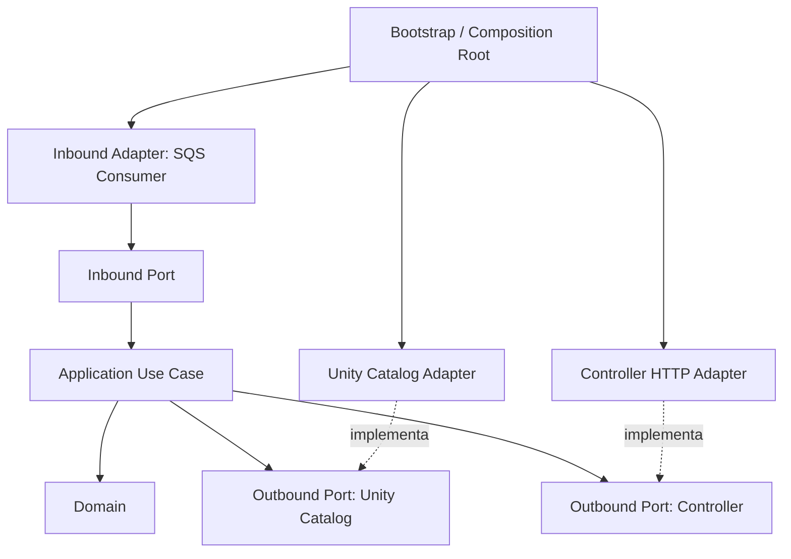

# 05 — Serviço Databricks: arquitetura hexagonal

## 1. Objetivo

Definir a organização interna do `analytics-share-grant-dbx-service`, mantendo regras de negócio independentes de SQS, HTTP, Databricks SDK e detalhes de infraestrutura.

## 2. Estrutura de diretórios sugerida

```text
analytics-share-grant-dbx-service/
├── domain/
│   ├── entities/
│   │   ├── permission.py
│   │   ├── resource.py
│   │   └── principal.py
│   ├── value_objects/
│   ├── enums/
│   │   ├── operation_type.py
│   │   ├── resource_type.py
│   │   └── privilege.py
│   ├── exceptions/
│   └── services/
│
├── application/
│   ├── ports/
│   │   ├── inbound/
│   │   │   └── process_request_port.py
│   │   └── outbound/
│   │       ├── unity_catalog_port.py
│   │       └── controller_port.py
│   ├── use_cases/
│   │   ├── process_request.py
│   │   ├── grant_permission.py
│   │   └── revoke_permission.py
│   ├── workflows/
│   │   └── permission_workflow.py
│   ├── services/
│   │   ├── operation_planner.py
│   │   ├── permission_analyzer.py
│   │   └── validation_service.py
│   └── dto/
│       ├── permission_request_dto.py
│       └── operation_result_dto.py
│
├── adapters/
│   ├── inbound/
│   │   └── sqs/
│   │       └── permission_request_consumer.py
│   └── outbound/
│       ├── databricks/
│       │   └── unity_catalog_adapter.py
│       └── controller/
│           └── controller_http_adapter.py
│
├── infrastructure/
│   ├── config.py
│   ├── logging.py
│   └── observability.py
│
├── bootstrap.py
└── pyproject.toml
```

## 3. Responsabilidades das camadas

### Domain

Contém conceitos e regras de negócio independentes de tecnologia:
- `Permission`
- `Resource`
- `Principal`
- `Operation`
- Tipos de recurso, operação e privilégio.
- Invariantes e exceções de domínio.

Não deve importar boto3, Databricks SDK, FastAPI, clientes HTTP ou bibliotecas AWS.

### Application

Coordena os casos de uso e define os contratos necessários.

- `ports/inbound`: contratos de entrada que expõem capacidades da aplicação.
- `ports/outbound`: contratos de recursos externos necessários aos casos de uso.
- `use_cases`: executam operações de aplicação.
- `workflows`: coordenam a sequência de atividades internas.
- `services`: planejamento, análise e validações de aplicação.
- `dto`: contratos de dados de entrada/saída da aplicação.

### Adapters inbound

Traduzem protocolos externos para chamadas da Application.

Exemplo: SQS Consumer:
1. Recebe a mensagem.
2. Desserializa e valida o envelope técnico.
3. Converte o payload para DTO.
4. Invoca o inbound Port/use case.
5. Confirma a mensagem somente quando a política de processamento permitir.

O consumer não deve conter regras de Grant/Revoke.

### Adapters outbound

Implementam Ports outbound.

- `UnityCatalogAdapter`: implementa chamadas do Databricks SDK.
- `ControllerHttpAdapter`: envia o resultado final ao endpoint de callback do Controller.

### Bootstrap

É o composition root:
- Carrega configuração.
- Cria clientes concretos.
- Instancia adapters.
- Injeta adapters nos casos de uso.
- Configura e inicia o consumer.

## 4. Direção das dependências



O Adapter depende da abstração (Port) e a implementa. O Use Case depende da abstração, não da implementação concreta. O Bootstrap conhece ambos para conectá-los.

## 5. Workflow interno inicial

Exemplo conceitual para uma solicitação Grant:

1. Interpretar a operação e montar um plano.
2. Validar o principal conforme a política definida.
3. Validar a existência e o tipo do recurso.
4. Consultar permissões atuais.
5. Determinar quais privilégios ainda precisam ser concedidos.
6. Aplicar somente as alterações necessárias.
7. Verificar o resultado, quando necessário.
8. Construir o resultado final e enviar callback ao Controller.

Para Revoke, definir política explícita para permissões ausentes. Em geral, uma operação idempotente pode considerar “já não existe” como resultado efetivo de sucesso, desde que isso corresponda ao contrato de negócio.

## 6. Port outbound — exemplo

```python
from abc import ABC, abstractmethod


class UnityCatalogPort(ABC):
    @abstractmethod
    def principal_exists(self, principal):
        raise NotImplementedError

    @abstractmethod
    def resource_exists(self, resource):
        raise NotImplementedError

    @abstractmethod
    def list_permissions(self, resource, principal):
        raise NotImplementedError

    @abstractmethod
    def grant(self, resource, principal, privileges):
        raise NotImplementedError

    @abstractmethod
    def revoke(self, resource, principal, privileges):
        raise NotImplementedError
```

Na implementação real, preferir tipos explícitos de domínio em vez de parâmetros genéricos e retornos sem tipagem.

## 7. Regras de implementação

- Não importar SDK Databricks fora do adapter correspondente.
- Não importar boto3 fora de adapters/infrastructure que realmente o utilizem.
- Não fazer chamadas HTTP ao Controller diretamente de um Use Case; usar Port outbound.
- Não acoplar o workflow a nomes de filas.
- Não colocar lógica de domínio no SQS Consumer.
- Não criar adapter DynamoDB no serviço Databricks se o estado global continuar sob responsabilidade do Controller e não houver necessidade de estado local.
- Manter funções pequenas e tipadas; adotar lint, formatter e análise estática no CI.

## 8. Evolução futura

Se as etapas forem extraídas para serviços separados:
- Introduzir um orquestrador Databricks distribuído.
- Criar filas específicas por etapa.
- Fazer workers reportarem resultados ao orquestrador.
- Centralizar no orquestrador a decisão da próxima etapa.
- Persistir estado por etapa para retomada e auditoria.
- Manter o Controller externo informado sobre o estado global, sem transferir para ele a lógica do workflow Databricks.
